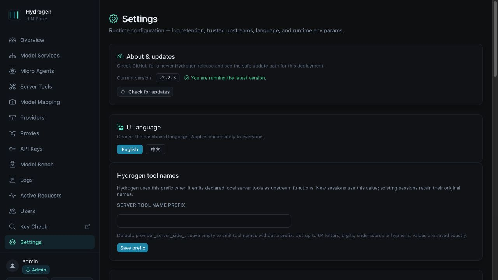
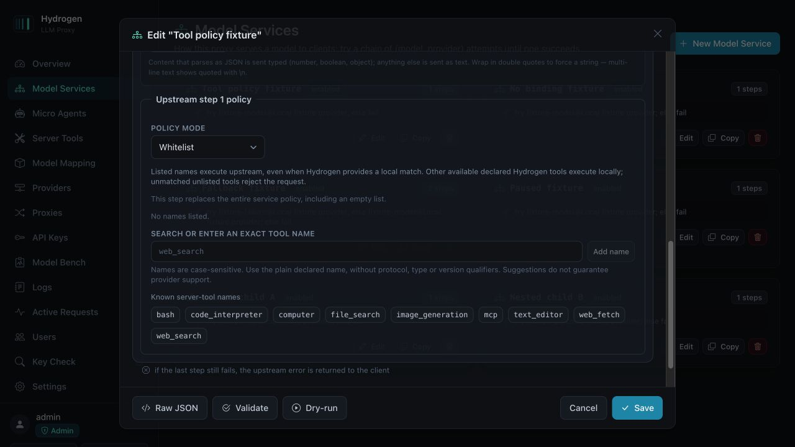
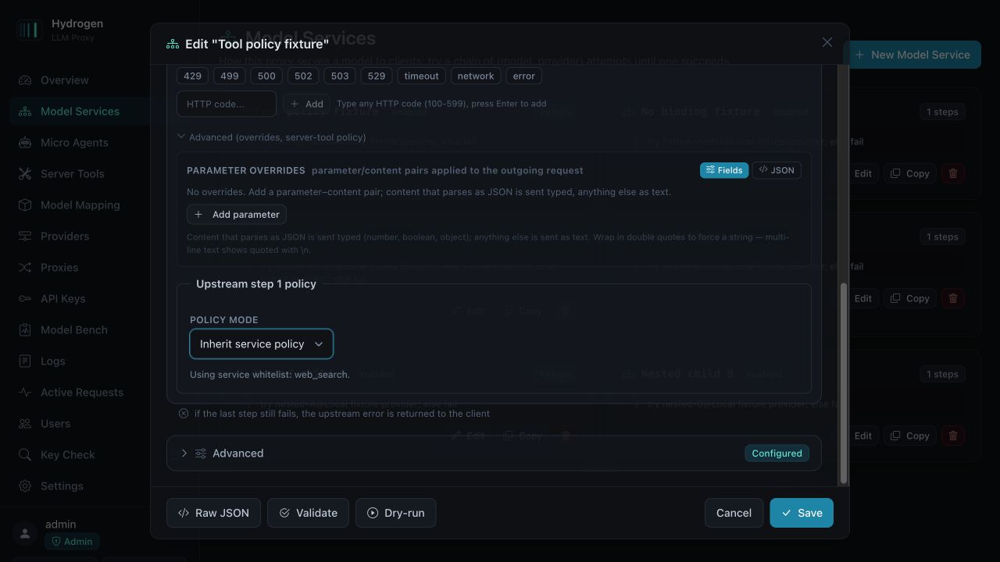
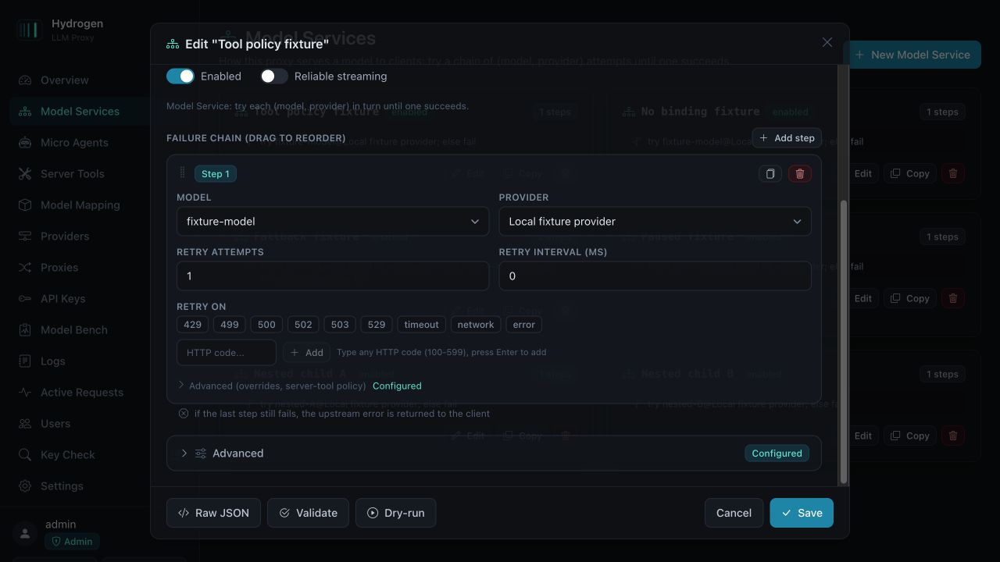
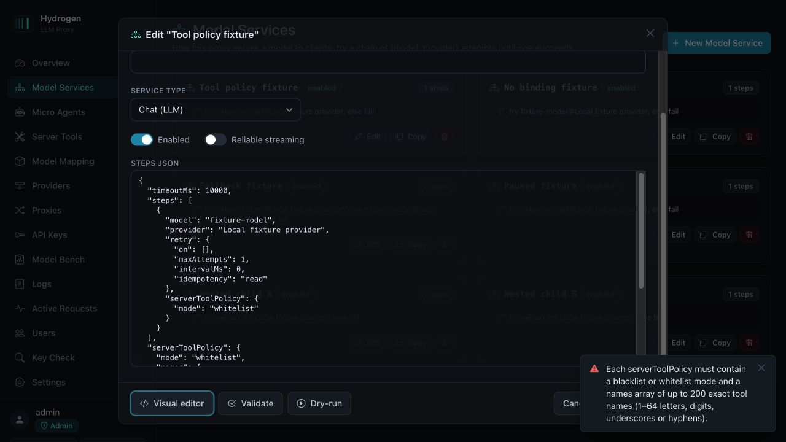
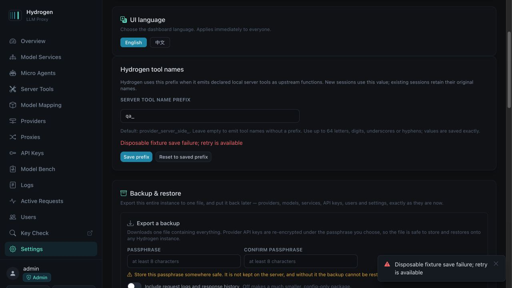

# HYD-TOOL-POLICY validation and local handoff

Local branch: `codex/hydrogen-tool-policy-preview`. Worktree: `/Users/samuel/Documents/Codex/2026-10-03/task-11/hydrogen-tool-policy`. Release baseline: `47397d97c209af695b7fc01ed376f2ddeaeda06b`. No push, publication, deployment, paid inference or production request is authorized or performed. The [feature card](feature-declared-tools-policy.md) was written before source edits.

The execution ledger below records the original policy branch's local validation. The later aggregate preview.2 has separately authorized dependency remediation/publication and must supply its own final-commit gates; these historical counts are not substituted for that verification. The AC7 wording below incorporates the owner's explicit historical-session acceptance on 2026-10-04.

## Implementation and migration

Bindings are availability, and each effective upstream step prepares declared tools after applying overrides. Preparation resolves exact ownership, applies the effective Model Service policy, rewrites local declarations and tool selections, and validates the final rendered request. The loop executes only entries in that prepared map, which contain the bound executor and its internal ID. Ordinary functions never gain authority from a prefix or alias. Local name conflicts use `hydrogen_tool_name_conflict`; blocked tools use native provider errors and perform no blocked-request dispatch.

The global setting defaults to `provider_server_side_` only when missing. An explicitly stored empty string is valid. The combined emitted name is validated for the selected egress family; invalid combinations reject locally without truncation. [OpenAI's Chat Completions function specification](https://developers.openai.com/api/reference/resources/chat/subresources/completions/methods/create) documents 64 characters, and [Anthropic's tool definition](https://platform.claude.com/docs/en/agents-and-tools/tool-use/define-tools) documents 128. Responses uses a conservative 64-character OpenAI function compatibility cap; this is not a separately verified Responses-specific maximum. A Model Service owns its blacklist/whitelist base policy. Each upstream failure-chain step inherits or replaces the entire policy; an empty list is a replacement. Micro Agent roots/stages reject policy fields and refer operators to the Model Service. The dashboard offers exact text entry and searchable known names, including services without bindings. Each upstream step's policy is inside that step's Advanced section, collapsed by default and marked Configured for explicit overrides, including empty lists. Service-level placement is unchanged. The separate HYD-TOOL-SELECTOR ticket is excluded; HostedToolBinding changes only its availability/declaration wording.

Saved Responses and conversations retain encrypted feature configuration: the recursive service/stage/OCR/ASR graph, policies, bindings, tool definitions/internal IDs and prefix. Continuations reconstruct the original executor/name mapping without consulting current feature settings. Each response retains an independent snapshot, and the conversation retains its first accepted configuration. API key ownership/scope, upstream catalog credentials, quota and SSRF checks remain live. The additive migration adds only nullable `service_snapshot_secret` columns to `stored_responses` and `response_conversations`. Snapshots can include adapter credentials, so they are encrypted with the configured master key and excluded from public responses.

Successful nested execution carries private receipts for an already-owned pending call. A receipt must match the exact executor ID, declaration, emitted name, arguments and private execution-instance token. The enclosing history retains its result once; this prevents a resumed nested operation from running again, including when a provider reuses a call ID. Fully completed internal stages keep their existing final-stage public projection. Public responses and conversation items omit the private provenance and snapshot fields.

Backup export seals session snapshots under the backup passphrase, removes source-key ciphertext from exported table rows, and validates correspondence and authentication before restore writes. Restore encrypts snapshots under the destination master key. Empty and pre-feature snapshots remain distinguishable. Legacy non-null source-key ciphertext can restore under its original key only; a cross-key legacy restore fails atomically instead of installing unusable sessions.

Clients that formerly relied on automatic binding injection must declare server tools. Previous saved responses and used conversations without a retained snapshot return a native 409 asking for a new session; the original configuration cannot be reconstructed safely. An unused conversation can capture its first configuration on first inference. No stored history is deleted by this refusal. The owner explicitly accepted this historical-session exception on 2026-10-04 at 04:40 UTC, message `Sentinel_3fd3a9393d988191a5cc8f0d09b5f741` in source thread `01a0fa97-234d-744a-b992-afc652f53017`. A continued snapshot-bearing session must use its original model-service name. The owner will communicate client migration; no general legacy layer is added.

## Entrypoints and capability limits

| Entrypoint | Session identity and behavior |
| --- | --- |
| `/v1/responses` | Always uses ResponsesController. `previous_response_id` and conversation identity retain the original snapshot; saved GET stream replay uses recorded events and sequence IDs. |
| `/v1/messages` through the existing hosted path | Anthropic uses ResponsesController when the service graph has a tool binding or a Hydrogen continuation. `hydrogen.previous_response_id` retains configuration and paused-call IDs. |
| Plain Anthropic full-history resend | Without a saved Hydrogen identity, this is stateless. It is evaluated as a new request and cannot be correlated to an earlier configuration. |
| Chat Completions and media endpoints | Stateless. No new top-level bound-tool loop or artificial identity is added. |
| Nested HostedToolService | Uses the existing buffered final-stage result behavior. Its Model Service applies policy and prepares its effective map; Micro Agent routing/buffering capabilities are preserved. |

Unsupported cross-family raw server declarations fail explicitly rather than silently becoming functions. Existing Responses server-tool presentation uses the renderer's search-call shape; this change does not introduce new upstream discovery or an arbitrary server-tool endpoint capability.

## Automated evidence

Environment: macOS arm64, Node `v22.22.2`, npm `10.9.7`. Both the untouched baseline archive and feature worktree use separate clean `npm ci` installations of the same committed lockfile. Installation was staged with `--ignore-scripts`; reviewed native rebuilds were limited to argon2, better-sqlite3 and esbuild. All 445 registry resolutions are npmjs sources; only workspace links are local. Loopback tests ran with narrowly authorized socket execution after the sandbox prevented binding. No existing server or production data was used.

Final checks ran after all receipt and reused-ID corrections, without subsequent implementation edits:

| Command | Final result |
| --- | --- |
| `npm run typecheck` | Both server and web passed. |
| `npm test` | 1,633 server tests in 80 files; 82 web tests in 8 files; 9 release-plan tests. All passed, exit 0. |
| `npm run build` | Web and server passed, exit 0. Vite retains its existing large-chunk advisory. |
| `git diff --check` | Passed. |
| `npm audit --json` | Five existing high package records from one inherited advisory; no critical, moderate or low advisories. Original policy dependencies unchanged. |

The untouched baseline passed both typechecks, 1,462 server tests in 75 files, 42 web tests in 6 files and build. No lint script exists. Final logs are in the sibling local `../evidence/acceptance-{typecheck,tests,build}.log`; independent review does not claim to have executed root's full gates. The final runtime fingerprint is retained in [manual run context](validation/HYD-TOOL-POLICY/manual-run-context.json) and independently matched to the current 183 runtime/workflow/script files. Documentation and screenshot updates do not change that fingerprint.

| AC | Evidence and result |
| --- | --- |
| 1: declaration/client ownership | **Pass.** Runtime/loop tests prove undeclared bindings expose/call nothing; stored names, aliases and guessed prefixes remain client-owned. Final HTTP no-declaration and ordinary-alias cases pass. |
| 2: prefix/exact executors | **Pass.** Prefix/settings, runtime and session tests cover missing/empty/custom prefixes, exact internal executor IDs, egress boundaries and unchanged adapter name. Final UI empty reload and HTTP empty-prefix case pass. |
| 3: collisions | **Pass.** Runtime tests cover duplicate server aliases, bound names and emitted/client names with zero provider/adapter counters. Session tests cover pre-stream/persistence rejection. Final HTTP conflict returns 400 with both counters zero. |
| 4: Model Service UI | **Pass.** Config/UI tests cover placement, exact names, raw/visual preservation and boundaries. Actual browser verifies search, controls without bindings, no Micro Agent policy editor and separate step Advanced placement. |
| 5: whole override | **Pass.** Runtime and UI/config tests preserve absent versus explicit empty. Final UI save/reload and HTTP empty-step override replace service bypass and execute locally. Inherit restoration clears the explicit indicator. |
| 6: decision order | **Pass.** All eight mode × listed × local-match combinations, native cross-family errors and effective overlays. Final HTTP whitelist bypass and unmatched local block pass. |
| 7: old/new sessions | **Pass for the accepted scope.** Snapshot/repository/backup tests cover edits, deletion, reconstruction, conversation/store:false, child deletion, prefixes, recursive graph, live authorization and cross-key restore. Final HTTP snapshot-bearing old-session bypass survives the UI edit. Historical used identities without snapshots require 409/new session under the owner's explicitly accepted exception; rejection tests assert zero model/adapter calls. This does not claim universal preservation of pre-feature sessions. |
| 8: wire coherence | **Pass.** Runtime, round-trip, large-argument, reasoning/controller/session tests cover choices, IDs, history, JSON/SSE and native resume results. Exact private-instance receipt tests and four persisted nested partitions prevent operation replay. Final HTTP mixed aliases, fallback streaming, saved Responses/Anthropic resumes and nested three-turn JSON/SSE pass. |
| 9: endpoint limits | **Pass within existing capabilities.** Runtime tests exercise nested HostedToolService and router/OCR preflight; the entrypoint inventory states stateless/buffered limits. Internal stage projection is preserved while pending-call receipts survive. |
| 10: preview isolation | `release-plan.test.mjs` covers automatic main/tag preview, explicit stable, historical/invalid tags, CLI output, exact 100/101 length limits and workflow guards. Independent release review passed; no GitHub Release/registry action was run. |
| 11: quality/review | **Pass.** Untouched baseline and final full gates pass. Three independent agent sessions report no unresolved scoped finding; source/test authors are separate. Lockfile is unchanged. |
| 12: actual interface | **Pass at desktop scope.** Actual Fastify app, fresh SQLite, browser interactions and real loopback fake sockets; 16 final HTTP scenarios, inspected screenshots and exercised validation/save-error recovery. |

Techniques address risk: equivalence partitions separate native server/client/no declarations and same/cross-family cases; boundary tests cover empty and maximum prefixes/names/lists, duplicate aliases and zero dispatch; decision tables cover interacting policy/match/list conditions; state transitions cover new session → configuration edit → old continuation/resume → new session, save failure → correction/retry, and inheritance → explicit replacement.

## Actual browser and functional acceptance

Used Codex's in-app browser against a disposable Fastify instance with synthetic admin/client/provider credentials and a fresh SQLite database under the task workspace. The provider and adapter were real loopback HTTP servers with deterministic responses and request-body counters. Update checks were stubbed locally to avoid GitHub calls. `ALLOW_PRIVATE_UPSTREAMS` was process-only for the disposable fixture; no persistent security setting or real deployment was changed.

Observed in the actual dashboard:

1. Invalid prefix `bad prefix!` shows an inline validation error; correcting it recovers. Explicit empty saves, reloads and remains empty.
2. An actual one-shot backend 503 on prefix save preserves the unsaved draft and displays the server error. Reset/retry succeeds, and reload confirms persistence.
3. The Model Service policy switches to whitelist, filters the known-name suggestions, adds `web_search`, validates, saves and survives reload. The separate step Advanced section is initially collapsed; expanding it displays inheritance and the service whitelist summary without opening service Advanced.
4. Changing that step to whitelist with no names validates, saves and survives reload. The collapsed step then shows Configured; expanding it explains whole-policy replacement. Invalid `bad name!` is rejected; correcting to `custom_tool` adds it and clears the error, and removal restores the empty list. Returning to inherit saves/reloads, removes Configured and restores the service-policy summary.
5. Raw JSON containing a step policy with missing names, or a root policy with null names, stays editable with an error. Correcting the JSON returns to the visual editor without reloading or losing the draft.
6. A service without a tool binding exposes policy controls. Expanded Micro Agent root/stage controls contain no upstream policy editor.

The final fixture was restarted after all runtime corrections at `http://127.0.0.1:58255` (fake provider/adapter port 58252). Sixteen HTTP scenarios passed between 11:18:42 and 11:25:16 UTC on 2026-10-03. Every ledger entry records its phase, timestamp, fixture and source-context reference; earlier preliminary runs are excluded from this final ledger.

| Final functional partition | Provider/adapter counts and outcome |
| --- | --- |
| Four base-policy cases | No declarations 1/0 with zero tool exposure; whitelist bypass 1/0 unchanged; unmatched block 0/0; ordinary alias 1/0 returned to client. |
| Three whole-override cases | Empty step policy local execution 2/1; old session keeps original bypass 1/0; emitted/client conflict 0/0 with Hydrogen conflict error. |
| Explicit empty prefix | 2/1; emitted `fixture_search`, adapter contract remains `fixture_search`. |
| Six review regressions | Typed client selection 1/0; mixed local/client alias JSON and SSE 1/1 with accepted client continuation; fallback overlay 4/1 with one completion; saved Responses and Anthropic resumes each 1/1 with original native result IDs. |
| Nested saved resume, JSON and SSE | Each three-turn case makes 6 model requests and 1 B-adapter request total. First is paused with zero adapters, second returns its result, third has no repeated tool/result events or adapter execution. |

The [final counter ledger](validation/HYD-TOOL-POLICY/manual-functional.json) and [source context](validation/HYD-TOOL-POLICY/manual-run-context.json) are tracked. Full command logs and disposable fixture scripts remain in the sibling task workspace. Synthetic token metadata and databases are private local fixtures and are excluded from the deliverable.

Screenshots were inspected at the desktop viewport by root and the independent test reviewer. Feature controls and inline alerts are readable without clipping. The transient malformed-JSON toast overlaps part of the modal footer in that error capture, and the save-failure toast overlaps unrelated lower backup content; correction/retry remains available and was exercised. Screenshot review by the independent reviewer is retained-image assessment, not a second live-browser run. No Android, separate mobile-browser, Docker runtime or live provider acceptance was performed.

## Independent review and remaining limits

These are separate independent AGENT SESSION reviews, not implementation-author self-review. Canonical session identifiers are exposed; the interface exposes no additional opaque session IDs. Reviewers authored neither implementation nor tests. All prompts are English; implementation/fix and bug-review sessions use gpt-6.1-sol max, without Astra.

| Independent session | Final evidence and disposition |
| --- | --- |
| `/root/code_review` | 160/160 runtime/loop/snapshot tests, 44/44 backup tests and 50/50 policy/editor tests; independent causal before/after diagnostics; final source fingerprint, 16 HTTP records and seven images inspected. No unresolved concrete finding; recommends local acceptance. |
| `/root/test_review` | 334/334 tests in 14 files; independently reproduces nested and reused-ID failures/fixes; assesses equivalence, boundaries, all eight decisions and lifecycle transitions. Full root logs, 16 HTTP records and seven images inspected. No remaining test/manual/visual blocker. |
| `/root/release_review` | 9/9 current committed release tests and prior independent 25-case CLI/output matrix. No remaining release-scope finding; actual Actions/registry/release execution unrun. |

Independent findings were fixed and retested:

| Severity | Finding | Correction and evidence |
| --- | --- | --- |
| P1 | Explicit function/custom selections could acquire local ownership through aliases. | Preserve ordinary reference class/name; no-adapter forced/mixed/custom diagnostics and tests pass. |
| P2 | Missing typed selections could pass against a native bypass declaration. | Validate declaration classes; native local rejection with zero dispatch. |
| P1 | A stray Responses name could conceal a blocked native tool type. | Resolve native type through the known-name registry; policy/selection counter tests pass. |
| P2 | Prefix plus stored name could exceed the emitted function limit. | Validate the egress name before dispatch/final rendering; exact boundaries pass without truncation. |
| P1 | Mixed aliases suppressed an ordinary client call. | Synthesize by explicit owned IDs; client call and continuation remain intact. This suppression was inherited. |
| P1 | Fallback overlays leaked local function calls and duplicate stream completion. | Buffer relevant overlays/nested paths; independent 4/1 diagnostic and final HTTP emit one native completion. |
| P1 | Portable backups retained source-key snapshot ciphertext. | Authenticate passphrase-sealed records before writes and re-encrypt for the destination key; independent different-key diagnostic and 44 tests pass. |
| P2 | Malformed raw policy shape crashed visual editing. | Validate before changing visual state; original reproduction and final browser recovery pass. |
| P1 | Completed nested work lost its parent receipt and repeated on the next turn. | Propagate exact private receipts for retained parent calls; independent adapter totals change from replay to 0 → 1 → 1, and four saved identity/SSE partitions pass. Baseline origin was not established. |
| P1 | Bare provider call IDs replayed an earlier completed operation on resume. | Select only unanswered owned instances. Independent four saved turns execute first/second operations once each; restoring only the old selector in a copied source repeats the first operation and returns 502. Six committed receipt-boundary tests pass. |
| P2 | Release metadata lacked a length boundary. | Reject overlength/historical/leading-zero version tags before outputs; 100/101 and CLI/output tests pass. |
| P2 | Historical refs could be mistaken for the new release policy. | Document that old refs retain old workflows and require a future commit containing the guards. |

Additional independent verification covers reserved canonical-history forgery rejection, saved native result/call-ID preservation and receipt privacy. Responses source projection now preserves native `type: "url"`. Tests for custom selections prove ownership/selection behavior; they do not establish a general native `custom_tool_call` return/replay capability. Reviewer diagnostic files remain under the disposable local `/tmp/hydrogen-f002-code-review` path; its earlier path label is not a roadmap/ticket assignment.

The unchanged dependency baseline has five high npm audit findings in the braces/chokidar/fast-glob/micromatch/tailwindcss chain and no critical findings. No dependency upgrade or package-version change is made in this feature. These existing advisories remain a separate maintenance limitation. GraphFlow MCP and CLI are unavailable; no GraphFlow execution episode was started or claimed closed. Real GitHub Actions Docker metadata integration, GHCR publication, GitHub prerelease creation and deployment remain unrun and separately authorized.

Implemented: **yes**. Full final checks: **passed**. Local AC acceptance: **supported for the scoped desktop/local feature**, with independent acceptance recommendation and no unresolved blocker. Released: **no**. HYD-TOOL-POLICY is a temporary descriptive ticket ID; no GitHub issue number is assigned, and historical roadmap IDs are unchanged. Parent/owner release or deployment acceptance remains a separate action.
